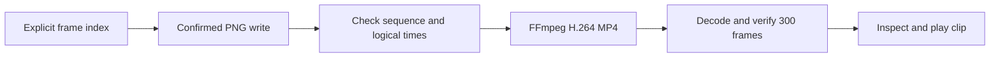

# Video export proof

[Video issue 9](https://github.com/owenlamont/annealer/issues/9) uses the existing
synthetic renderer and an external FFmpeg encode. No renderer changes or real-time
recorder are needed for an offline, shareable clip.

## Reproduce

Requirements: Rust toolchain/dependencies from the repository, a working Vulkan or
other supported graphics adapter, Bash, GNU `timeout`, `realpath`, `awk`, `jq`, and
FFmpeg/ffprobe with the `libx264` encoder. WSL software Vulkan also works.
Native Windows can run the recipe through WSL; the script is not a PowerShell script.
FFmpeg is an external development tool, not a bundled distribution dependency.

```sh
cargo build --locked -j 2
bash scripts/video-proof.sh target/debug/annealer "$HOME/agent-scratch/annealer-video"
```

The destination must be new. The script exports 300 frames at explicit times
`index / 30`, checks the complete numbered PNG set and CSV times, then encodes H.264
in MP4 with `yuv420p`, CRF 18 and fast-start metadata. Input rate is `-framerate 30`;
`-fps_mode passthrough` avoids rate-conversion duplication/drop. No wall-clock pacing
enters the timeline. Encoding/decoding use two threads; export and all media steps
have deadlines. Progress is in `export.log` and `encode.log` while the script runs.



The script retains source PNGs for comparison. After visual inspection, remove only
that run's `frames` subdirectory; retain `annealer.mp4`, `frames.csv`, `probe.json`
and logs. Failure leaves partial output for diagnosis; use a new destination on retry.
A partial MP4 is not a completed export merely because the file exists.

## Verified sample

The sample was produced from Annealer `ab25e9f` with FFmpeg 9.0.2 on WSL software
Vulkan (llvmpipe), with two encoder threads. These results establish correctness of
this sequence, not hardware GPU performance or cross-backend pixel identity.

| Property | Verified value |
| --- | --- |
| Container / codec | MP4 / H.264 |
| Pixel format | yuv420p |
| Dimensions | 1280 × 720 |
| Rate | 30/1 fps |
| Decoded frames | 300 |
| Duration | 10.000000 seconds |
| Bytes | 1,028,114 |
| Export wall time | 208.9 seconds after renderer readiness |

Decoded frames 0, 30, 90, 150 and 299 were extracted; early, middle and final frames
were visually inspected. Labels and document shapes remain readable; cyan and amber
remain distinct on the dark field. Creation/deletion occur near the beginning, then
avatars continue moving. The export does not repeat the four-second preview loop.
The existing static scene is a feasibility sample; crowded layout and final glow
remain [visual-study work](https://github.com/owenlamont/annealer/issues/12).

WSL FFplay completed a normal playback through WSLg. Its log reported 17 dropped
presentation frames under concurrent build load; the encoded video still contains
all 300 frames. Encoding cannot guarantee smooth real-time presentation on a busy host.
Native Windows FFplay 9.0.2 also completed playback, reading the WSL clip through its
UNC path; its log reported two dropped presentation frames under concurrent load.

```sh
ffplay -autoexit "$HOME/agent-scratch/annealer-video/annealer.mp4"
ffplay.exe -autoexit "$(wslpath -w "$HOME/agent-scratch/annealer-video/annealer.mp4")"
```

Alternatively open the MP4 in Windows Media Player or VLC. Native Media Player/VLC
were not tested. The generated clip is retained as a local deliverable, outside Git;
regenerate with the script rather than committing hundreds of intermediate PNGs.

## Failures and next step

- Existing destinations fail before export; stale sequences are never reused.
- Missing FFmpeg, ffprobe, jq or timeout fails before creating output.
- Missing libx264 or graphics support fails with the relevant captured tool log.
- Wrong dimensions/rate/duration, missing PNGs or incomplete decoded frame counts fail
  verification. A full decode also checks for media errors.
- WSL/Windows installation paths differ; use `wslpath -w` for Windows player arguments.

Keep offline export as the first product path: explicit duration/rate plus an output
file, with confirmed completion and a useful error. A live recorder should be a separate
requirement only if interactive camera capture is wanted; live recording drops or
resamples frames when presentation cannot keep up. Streaming raw frames to FFmpeg
could remove PNG I/O later, after profiling, while preserving explicit frame times and
backpressure. No production export UI or FFmpeg bundling is implemented here.

See [FFmpeg's image sequence input][image2], [video timing options][timing] and
[MP4 fast-start option][mp4] for the upstream contracts.

[image2]: https://ffmpeg.org/ffmpeg-formats.html#image2-1
[timing]: https://ffmpeg.org/ffmpeg.html#Advanced-Video-options
[mp4]: https://ffmpeg.org/ffmpeg-formats.html#mov_002c-mp4_002c-ismv
